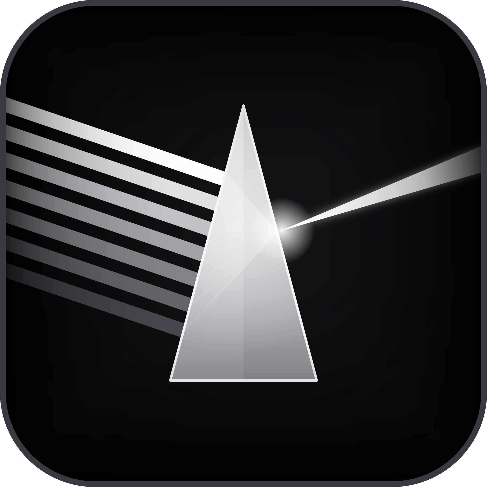
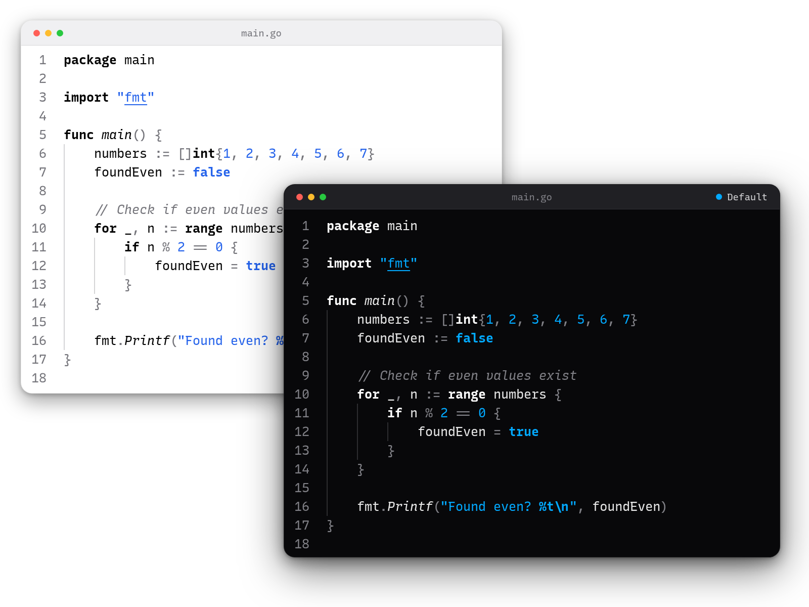

<p align="center">
  
</p>

<h1 align="center">Monochromator</h1>

<p align="center">
  <a href="https://codeberg.org/beem/monochromator/issues"></a>
  <a href="https://open-vsx.org/extension/beem/monochromator"></a>
  <a href="https://codeberg.org/beem/monochromator/raw/branch/master/LICENSE"></a>
</p>

<p align="center">
  Distraction-free <b>monochrome</b> coding theme
</p>



## Installation

All themes can also be found under [Actions](https://codeberg.org/beem/monochromator/actions).

<details>
<summary></summary>

<br>

Install from [Open VSX](https://open-vsx.org/extension/beem/monochromator), the [Visual Studio Marketplace](https://marketplace.visualstudio.com/items?itemName=beem.monochromator), or directly in your editor.

To ensure 100% correct behaviour, it is recommended to add the following to your `settings.json`:

```json
{
  // This ensures that string interpolation delimiters look right
  "editor.bracketPairColorization.enabled": false,

  // This ensures that variables do not look similar to comments
  "editor.showUnused": false
}
```

</details>

<details>
<summary></summary>

*Work in progress*

</details>

## Contributing

If something looks off with the syntax highlighting, please [open an issue](https://codeberg.org/beem/monochromator/issues) with the editor and language you were using, a screenshot, and a description of how you think it should look instead.

Please keep in mind that I am primarily focusing on the Visual Studio Code variant, so the quality in other editors might vary.

## License

Copyright © 2025 Josias Beem

Licensed under the **MIT License**
